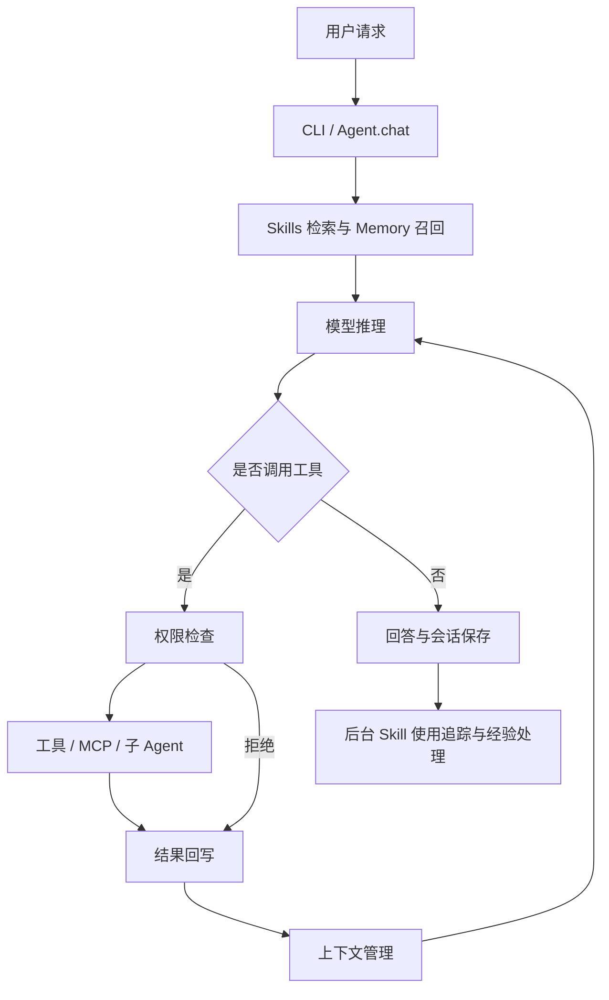

# Agentic Harness

**面向工具执行、长任务上下文管理与经验演化的 Python Agent 运行框架。**

模型提出行动，Harness 负责权限判断、工具执行、结果回写和状态管理。项目支持本地代码探索与编辑任务，接入 OpenAI-compatible / Anthropic-compatible 模型接口，并通过 MCP、Memory、Skills 和子 Agent 扩展能力。

## 核心能力

| 模块 | 实现 |
| --- | --- |
| Agent Loop | 流式模型调用、tool call 解析、结果配对回写、异常重试、轮次与估算费用预算 |
| 权限与文件操作 | 多级权限模式、Plan Mode、危险命令检测、编辑前读取与文件修改时间检查 |
| 上下文管理 | 工具结果截断、旧结果裁剪、大结果落盘引用，以及结构化会话记忆折叠 |
| Skills | SKILL.md 加载、BM25-lite 检索、inline/fork 执行、反馈驱动的 add/merge/discard |
| Memory 与会话 | 按项目路径区分长期记忆、辅助模型召回、会话自动保存与恢复 |
| 扩展 | stdio JSON-RPC MCP 客户端，explore / plan / general 子 Agent |
| 评测 | 折叠开关同题对照、Skill 规则回放、候选比较、来源与版本记录 |

## 运行流程



会话折叠保存三类状态：`episode_memory` 记录任务与已发生事件，`working_memory` 记录当前目标和下一步，`tool_memory` 记录工具使用经验。支持用户 `/compact`、模型调用 `compact_context` 与上下文阈值触发；可采用一次结构化生成或三路并行生成。

Skills 演化在上一轮任务与回答中保留 pending window，结合下一轮用户消息抽取稳定规则，由 Extractor / Maintainer 决定新增、合并或丢弃。写入受权限控制，修改前保存历史快照，并记录来源和使用情况。该过程更新方法文件，不训练模型参数。

## 快速开始

需要 Python 3.11+ 和可用的模型接口；代码仓库分析建议安装 Git、ripgrep。

```bash
git clone https://github.com/NINE-gatsby/Mini-dsh.git
cd Mini-dsh
python -m venv .venv
```

激活虚拟环境：

```bash
# macOS / Linux
source .venv/bin/activate
```

```powershell
# Windows PowerShell
.\.venv\Scripts\Activate.ps1
```

安装依赖，并复制配置模板：

```bash
python -m pip install -r requirements.txt
python -c "from pathlib import Path; p=Path('.env'); p.exists() or p.write_bytes(Path('.env.example').read_bytes())"
```

在 `.env` 中填写真实的 `APIKEY`、`API` 和 `MODEL`。通用 `API` 路径包含适用的 `/anthropic` 路径时选择 Anthropic-compatible 协议，否则按 OpenAI-compatible 协议调用；也支持模板中的独立 provider 配置。`--model` 可覆盖模型设置。不要提交真实 `.env`。

```bash
# 交互会话
python -m agents.main

# 只读分析与计划；允许写入指定计划文件
python -m agents.main --plan "分析这个项目的 Agent Loop 和工具权限"

# 一次性任务
python -m agents.main --max-turns 12 "说明 Skills 检索的实现位置和流程"

# 恢复最近保存的会话消息
python -m agents.main --resume
```

CLI 和存储目录沿用底座的 Bear Code / `.bear` 命名；对外项目名称为 Agentic Harness。

## Skills 与 MCP

项目级 Skills 放在 `.bear/skills/<skill-name>/SKILL.md`，用户级位于 `~/.bear/skills/`。最小格式示例：

```markdown
---
name: code-review
description: Review code changes for correctness and regressions.
when-to-use: When reviewing a patch or changed function.
context: inline
---
Read the affected code and its callers. Identify concrete correctness issues.
Explain each issue with a reproducible condition and a relevant file location.
Distinguish confirmed findings from assumptions.
```

`context: fork` 会在独立子 Agent 上下文中执行。后台经验写入需要启用 `BEAR_AUTO_SKILL_EVOLUTION`，且权限模式允许写入，例如显式使用 `--accept-edits`。会话中可使用 `/skills`、`/skill-eval` 和 `/compact`。

MCP 服务配置从 `.mcp.json`、项目 `.bear/settings.json` 或用户 `~/.bear/settings.json` 读取，使用 `mcpServers` 下的 `command`、`args` 和可选 `env` 启动 stdio 服务。服务配置可能包含凭据，因此不随仓库分发；首次对话时初始化并发现工具。

## 测试与评测

离线单元测试使用 `unittest`，无需模型凭据：

```bash
python -m unittest discover -s tests -v
```

当前测试覆盖折叠开关、历史替换、折叠次数限制、三路生成、异常回退，以及答案判分和成对评测轨迹保存。测试中的模型调用使用 Mock，不代表真实任务成功率。

先校验最小样例，不调用模型：

```bash
python -m agents.eval_folding --cases data/folding_eval_smoke.jsonl --output .bear/folding-eval/smoke-001 --validate-only
```

配置模型后，运行折叠开启/关闭对照；此命令产生模型调用费用，输出目录必须尚不存在：

```bash
python -m agents.eval_folding --cases data/folding_eval_smoke.jsonl --output .bear/folding-eval/smoke-001 --fold-after-turn 2
```

输出包含逐题答案、判分、轨迹、折叠事件、token 与汇总。样例只验证链路，不用于报告通用 benchmark 成绩。`--fold-memory-mode single_json` 可切换折叠生成方式。

`/skill-eval` 对历史回复和候选回复进行规则回放，结合程序检查与 LLM judge，记录候选、比较结果及 champion 快照。当前旧版历史回复与候选重新生成回复的比较并非完整对称 A/B，也不会将 champion 自动发布为活跃 Skill；规则通过率不等于完整 Agent 的任务成功率。

## Docker

仓库提供容器构建配置，实际运行仍需模型服务配置与工作目录。以下示例在仓库根目录执行：

```bash
docker build -t agentic-harness .
docker run --rm -it --env-file .env --mount "type=bind,source=${PWD},target=/workspace" agentic-harness
```

镜像包含 Python、Git、ripgrep、Node.js 与 Playwright Chromium；可选 MCP 配置由工作目录挂载。容器运行时的修改会反映到挂载目录，权限规则与容器挂载范围需要按实际用途配置。

## 源码导航

| 文件 | 职责 |
| --- | --- |
| [agents/main.py](agents/main.py) | CLI、环境配置与交互入口 |
| [agents/agent.py](agents/agent.py) | Agent Loop、模型适配、工具调度与上下文管理 |
| [agents/tools.py](agents/tools.py) | 文件工具、Shell、权限与编辑前检查 |
| [agents/session_memory.py](agents/session_memory.py) | 折叠记忆结构、解析与回退 |
| [agents/skills.py](agents/skills.py) | Skills 发现、检索与执行 |
| [agents/online_skill_evolution.py](agents/online_skill_evolution.py) | 反馈抽取与维护决策 |
| [agents/skill_evolution.py](agents/skill_evolution.py) | Skill 文件、版本与来源记录 |
| [agents/online_skill_eval.py](agents/online_skill_eval.py) | 回放、规则判分和候选比较 |
| [agents/memory.py](agents/memory.py) | 项目长期记忆与召回 |
| [agents/mcp_client.py](agents/mcp_client.py) | stdio MCP 服务连接与工具路由 |
| [agents/subagent.py](agents/subagent.py) | 子 Agent 配置与工具范围 |
| [agents/eval_folding.py](agents/eval_folding.py) | 折叠成对评测入口 |

## 当前边界

- 本地 Shell 由宿主进程执行，危险命令检测不是完整安全沙箱。
- 会话恢复针对历史消息，不是正在运行的进程或任意指令位置的恢复。
- Skill 快照支持追溯与人工恢复，尚无完整自动回滚发布流程。
- 折叠和经验抽取可能遗漏或误解信息；效果需要固定模型、任务、工具与预算进行实测。
- 工具层可能在持久化前截断结果；大输出落盘不保证保存所有原始数据。
- 费用预算使用固定费率估算，应以实际模型服务账单为准。

## 来源与许可

基础 Agent Runtime 参考并复用 [claude-code-from-scratch](https://github.com/Windy3f3f3f3f/claude-code-from-scratch)，包括工具、提示词、Memory、MCP 与子 Agent 等实现；本项目在此基础上扩展会话折叠、Skills 演化及相关评测。上游版权与 MIT 许可保留于 [LICENSE](LICENSE)。

本仓库不将外部论文的 benchmark 数字作为本项目实测成绩。
